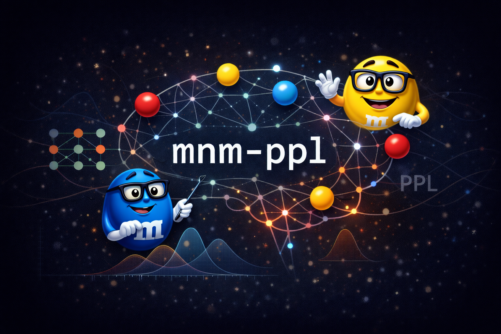

# Marburg-Mannheim Perplexity Transdiagnostic

<p align="center">
  
</p>

Perplexity Pipeline: Cooperation Marburg-Mannheim

## Setup

```bash
git clone https://github.com/42elenz/mnm_ppl.git
cd mnm_ppl
uv sync
```

## Usage

```bash
uv run mnm_ppl
```
